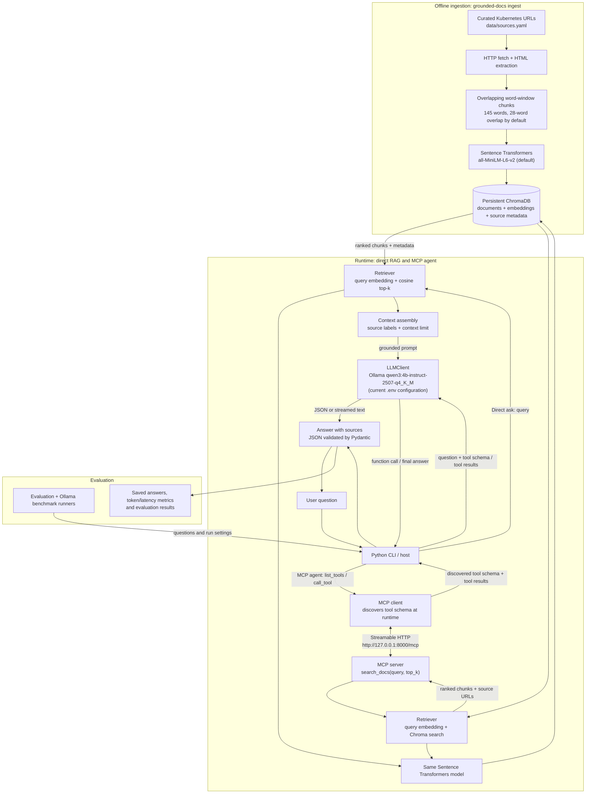

# GroundedDocs

**An evaluated documentation agent with RAG, MCP, hosted/local LLM inference, and token benchmarks.**

GroundedDocs is a small Python application that answers questions from a curated set of public Kubernetes documentation pages. It demonstrates the end-to-end engineering path: document ingestion, embeddings, vector retrieval, grounded generation, JSON output, streaming, LLM tool calling, MCP tool discovery/invocation, evaluation, prompt/context optimization, and local quantized-model benchmarking.

> This repository contains the implementation and evaluation harness. Run the ingestion and experiments on your machine, then review the generated answers and record human scores.

## What it demonstrates

- **LLM API:** OpenAI Chat Completions with streaming and strict JSON Schema output; Ollama through its OpenAI-compatible endpoint.
- **RAG:** public docs → HTML extraction → chunking → Sentence Transformers embeddings → persistent ChromaDB → top-k retrieval.
- **Grounded answers:** source labels, source URLs, insufficient-context flag, and Pydantic validation.
- **Tool calling + MCP:** the MCP server exposes `search_docs`; the agent discovers its schema using an MCP client and dynamically passes the discovered schema to the LLM's function-calling interface.
- **Evaluation:** a 20-question JSONL set with retrieval hit rate, citation-source precision, abstention accuracy, token counts, latency, and a clearly labelled lexical fact-coverage proxy. Human review is intentionally left as a separate step.
- **Optimization:** baseline and optimized runs use different top-k/context budgets so token use and quality proxies can be compared.
- **Local models:** Qwen3 4B Instruct 2507 Q4_K_M and Q8_0 tags are benchmarked with the same questions and settings.

## Architecture



The current `.env` configuration uses Ollama with `qwen3:4b-instruct-2507-q4_K_M` for generation and `sentence-transformers/all-MiniLM-L6-v2` for document and query embeddings. Without provider settings, the code falls back to OpenAI `gpt-4.1-mini`; set `LLM_PROVIDER` and the corresponding model variable to select another provider/model. In the MCP path, the Python host makes the LLM requests and bridges function calls to the MCP client; the MCP server only exposes document search and does not call an LLM.

## Repository layout

```text
grounded-docs-agent/
├── data/
│   ├── sources.yaml
│   └── evaluations/
│       ├── questions.jsonl
│       └── results/              # generated locally; ignored by Git
├── scripts/
├── src/grounded_docs/
│   ├── ingest.py                 # fetch and parse public docs
│   ├── chunking.py               # overlapping word-window chunks
│   ├── embeddings.py             # Sentence Transformers adapter
│   ├── vector_store.py           # ChromaDB adapter
│   ├── retrieval.py              # common retrieval service
│   ├── llm_client.py             # OpenAI/Ollama adapter
│   ├── answer_generator.py       # RAG + citations + JSON/streaming
│   ├── mcp_server.py             # MCP search_docs server
│   ├── mcp_client.py             # discover and invoke MCP tools
│   ├── tool_agent.py             # LLM ↔ MCP tool-calling loop
│   ├── evaluation.py             # fixed-question evaluation
│   ├── benchmark.py              # Ollama quantization benchmark
│   ├── compare.py                # baseline vs optimized report
│   └── cli.py                    # command-line interface
└── tests/
```

## Requirements

- Python 3.11 or later.
- Internet access for first-time document ingestion and model downloads.
- An OpenAI API key for hosted inference, **or** Ollama installed and running for local inference.
- Enough RAM for the embedding model and the selected local LLM. Actual local inference memory is greater than the model-file size.

The package uses the MCP Python SDK v2 API (`MCPServer` and `mcp.Client`). If you have old v1 MCP examples installed elsewhere, do not mix those imports with this project.

## Installation

### 1. Create and activate a virtual environment

Windows PowerShell:

```powershell
py -3.11 -m venv .venv
.\.venv\Scripts\Activate.ps1
python -m pip install --upgrade pip
pip install -e ".[dev]"
```

macOS/Linux:

```bash
python3.11 -m venv .venv
source .venv/bin/activate
python -m pip install --upgrade pip
pip install -e ".[dev]"
```

### 2. Configure the provider

```bash
cp .env.example .env
```

On Windows PowerShell use:

```powershell
Copy-Item .env.example .env
```

For OpenAI, set `OPENAI_API_KEY` in `.env`. The default model is configurable through `OPENAI_MODEL`.

For Ollama, install Ollama, then download one of the supported Qwen tags:

```bash
ollama pull qwen3:4b-instruct-2507-q4_K_M
ollama pull qwen3:4b-instruct-2507-q8_0
```

Change `.env`:

```env
LLM_PROVIDER=ollama
OLLAMA_BASE_URL=http://localhost:11434/v1
OLLAMA_API_KEY=ollama
OLLAMA_MODEL=qwen3:4b-instruct-2507-q4_K_M
```

The exact tags above are published in the Ollama Qwen3 model registry. Check the registry before running if tags have changed.

## Quick start

### 1. Build the knowledge base

```bash
grounded-docs ingest
```

To delete and recreate the current collection:

```bash
grounded-docs ingest --reset
```

The initial Sentence Transformers model download can take time. The Chroma index is stored locally under `data/chroma/` and is excluded from Git.

### 2. Ask a RAG question

```bash
$env:HF_HUB_OFFLINE = "1" # Offline moded enabled. If Embedding Model is already cached and you want to prevent Hub requests.
grounded-docs ask "How does a Kubernetes Service select Pods?"
```

### 3. Get structured JSON

```bash
grounded-docs ask --json "Explain the difference between readiness and liveness probes."
```

The answer schema is:

```json
{
  "answer": "...",
  "sources": ["S1", "S2"],
  "insufficient_context": false
}
```

The application validates the model output with Pydantic. OpenAI requests strict JSON Schema output; Ollama uses JSON mode followed by local Pydantic validation.

### 4. Stream a response

```bash
grounded-docs ask --stream "What is a StatefulSet?"
```

### 5. Start the MCP server

Open terminal 1:

```bash
grounded-docs mcp-server
```

Alternative command (same entrypoint):

```bash
python -m grounded_docs.mcp_server
```

The MCP endpoint is `http://127.0.0.1:8000/mcp` by default. The server exposes `search_docs(query, top_k)`.

### 6. Use the LLM tool-calling path

Keep the MCP server running and open terminal 2:

```bash
grounded-docs ask --agent "How does a Kubernetes Service select Pods?"
```

The agent does the following at runtime:

1. Connects to the MCP endpoint using `mcp.Client`.
2. Calls `list_tools()` and reads the `search_docs` input schema.
3. Converts the discovered schema into an OpenAI-compatible function tool.
4. Sends the user question and tool definition to the configured LLM.
5. Executes the returned function call through `client.call_tool()`.
6. Appends the tool result to the conversation and asks the model to formulate its answer.

This is the actual MCP-client-to-LLM bridge. MCP itself does not make the LLM call; the Python host coordinates both sides.

The CLI and MCP server log the flow to the console at INFO level: retrieval queries and returned chunks, discovered MCP tool schemas, tool-call arguments and results, and LLM requests and responses. These logs include the question and retrieved document text; avoid using them with sensitive content. In this implementation, the MCP server does **not** call the LLM: the host sends the question and discovered tool schema to the LLM, sends any LLM-requested tool call to the MCP server, then supplies the server's result to the LLM.

## Evaluation

The fixed set in `data/evaluations/questions.jsonl` contains 20 Kubernetes questions: factual, multi-concept, conceptual, similar-concept, and out-of-corpus questions.

Run the baseline:

```bash
grounded-docs evaluate --mode baseline
```

Run the optimized configuration:

```bash
grounded-docs evaluate --mode optimized
```

The runs are saved as JSON and CSV under `data/evaluations/results/`.

### Metrics and interpretation

| Metric | Meaning | Caveat |
|---|---|---|
| Retrieval Hit@k | At least one expected source URL appeared in the retrieved top-k | Tests source retrieval, not answer correctness |
| Citation source precision | Cited source labels map to expected source URLs | Does not prove that each citation entails the claim |
| Abstention accuracy | Whether out-of-corpus questions were marked insufficient | Binary metric on a small test set |
| Lexical fact coverage proxy | Share of expected-fact terms present in the answer | **Not semantic accuracy**; paraphrases may score poorly |
| Prompt/completion tokens | Provider-reported usage when available; otherwise estimates | Tokenizer estimate may differ from provider billing |
| Estimated cost | Usage multiplied by prices in `.env` | Prices are not hard-coded; set current model prices |
| Latency | Retrieval + generation wall time | Depends on hardware, network, provider load and warm/cold state |

**Human review is required.** Open the CSV, read the answer for each question, and fill `human_score` with a consistent rubric (for example 0 = incorrect/unsupported, 1 = partially correct, 2 = correct and sufficiently cited). The program leaves it blank rather than pretending an LLM or lexical heuristic is ground truth. The `compare` command reads completed `human_score` values from each result CSV and includes their averages in the comparison table.

### Token optimization experiment

The baseline and optimized settings are controlled in `.env`:

- Baseline: `BASELINE_TOP_K=8`, `BASELINE_CONTEXT_CHARS=14000`.
- Optimized: `OPTIMIZED_TOP_K=4`, `OPTIMIZED_CONTEXT_CHARS=6500`.

Compare average prompt tokens, total cost, retrieval hit rate, citations, abstention, and human review scores. If answer quality drops, adjust top-k/context and rerun. Do not claim a token reduction without measuring it, and do not treat a lexical proxy as the quality gate.

After both runs finish, compare the generated JSON files automatically (adjust filenames for your provider/model):

```bash
grounded-docs compare \
  data/evaluations/results/openai-gpt-4.1-mini-baseline.json \
  data/evaluations/results/openai-gpt-4.1-mini-optimized.json \
  --output data/evaluations/results/comparison.md
```

For OpenAI costs, set `OPENAI_INPUT_PRICE_PER_1M` and `OPENAI_OUTPUT_PRICE_PER_1M` to the current model's prices. If unset, the cost field is `null` rather than a fabricated number. For Ollama, API cost is recorded as zero; electricity and hardware depreciation are excluded.

## Local Q4 vs Q8 benchmark

Make sure Ollama is running and set `LLM_PROVIDER=ollama` in `.env`:

```bash
grounded-docs benchmark-ollama
```

Or explicitly provide model tags:

```bash
grounded-docs benchmark-ollama --models \
  qwen3:4b-instruct-2507-q4_K_M \
  qwen3:4b-instruct-2507-q8_0
```

The benchmark uses the same corpus, questions, embedding model, top-k and context budget for each quantization. It records:

- Model tag and full evaluation duration.
- Sampled Ollama daemon + child-process peak RSS when discoverable.
- Average end-to-end question latency, first-question latency, and warm average latency.
- Aggregate generated tokens per second (includes evaluation/retrieval overhead; it is **not** pure model decode speed).
- Retrieval/citation/abstention and lexical quality proxies.

The memory sampler may report `null` on platforms where the Ollama daemon/runner processes cannot be identified. Record machine specifications (CPU, RAM, GPU, OS) with your results. Model file size is not runtime memory.

## Tests and code quality

```bash
pytest -q
ruff check .
```

Tests cover chunking behavior, token-cost arithmetic, output-schema parsing, and the evaluation dataset. They do not call a paid LLM or download the embedding model.

## Known limitations

- The initial crawler fetches a curated list of pages and extracts article text. It is not a general-purpose crawler and may need selector updates if the documentation site changes.
- Chunk length uses word counts as a practical proxy, not an exact tokenizer count.
- The chosen embedding model can truncate long text; keep chunks small and inspect model logs.
- Retrieval is dense-vector-only; BM25/hybrid retrieval and reranking are natural improvements.
- Lexical fact coverage is a debugging metric, not a semantic correctness score.
- MCP server access is local and unauthenticated by default. Do not expose it publicly without authentication, authorization, network controls and review.
- Tool-agent `asyncio.run()` calls are designed for this synchronous CLI, not for use inside an already-running async web server.

## License

MIT. Kubernetes documentation remains subject to its own licensing and attribution terms; this project stores only a local generated index and the source URL list, not copies of the source pages in Git.
